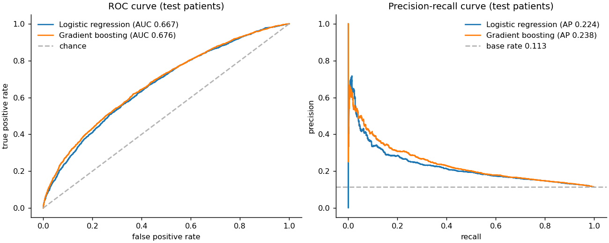
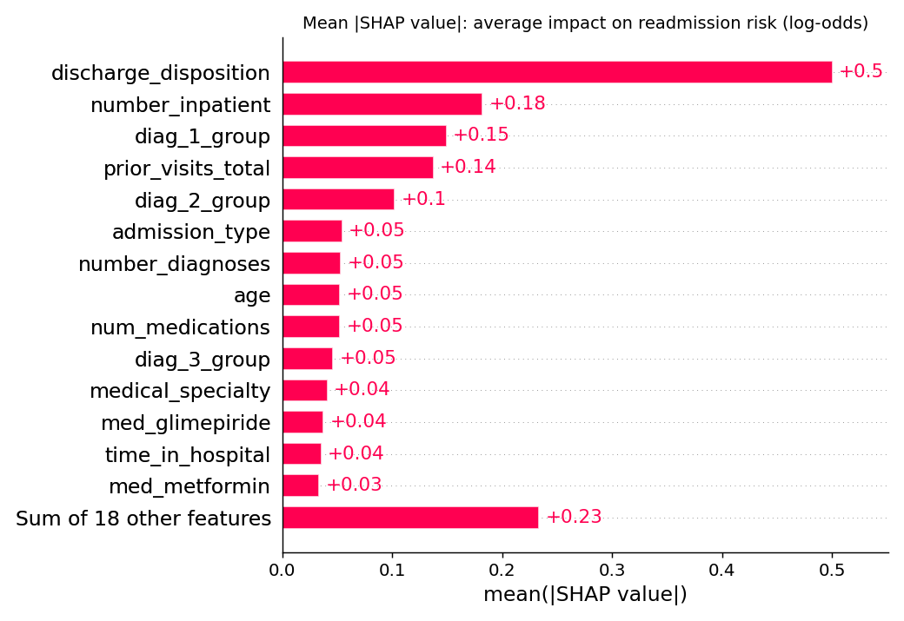
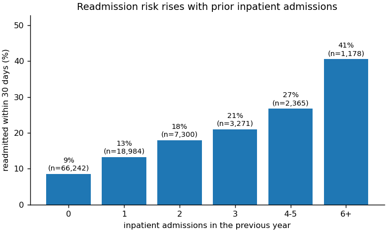
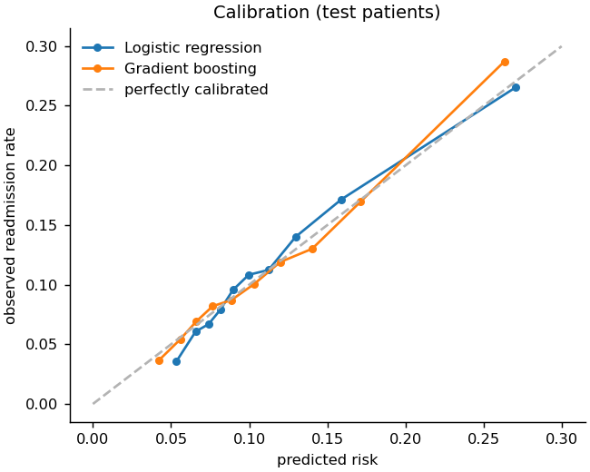

# Hospital Readmission Risk Prediction

Predicting which patients with diabetes will be **readmitted to hospital within 30 days of discharge**, using ten
years of records from 130 US hospitals, and explaining each prediction with **SHAP**.

Unplanned 30-day readmissions are costly for hospitals and harmful for patients. A risk score available at
discharge lets care teams target follow-up calls, medication reviews and early outpatient visits at the patients
who need them most.

## Results (held-out test patients)

| Model | ROC AUC (95% CI) | PR AUC | F1 | Precision | Recall | Patients flagged |
|---|---|---|---|---|---|---|
| Logistic regression | 0.668 (0.656–0.680) | 0.224 | 0.276 | 0.210 | 0.406 | 22.0% |
| **Gradient boosting** | **0.676 (0.665–0.689)** | **0.238** | **0.289** | **0.211** | **0.458** | 24.6% |

* Test set: 19,773 encounters from patients the models never saw during training.
* The decision threshold is chosen to maximise F1 on a separate validation set, never on the test set.
* Only 11.4% of encounters end in a 30-day readmission, so a random guess has a precision of 0.114. At its
  threshold, the gradient-boosting model flags a quarter of discharges and catches **46% of all readmissions**,
  with a precision of 0.21 (about **1.9× the base rate**).
* An AUC around 0.68 is in line with what is usually reported for this dataset. Administrative records
  (diagnoses, visit counts, medications) carry only part of the signal; social factors and post-discharge care,
  which are not in the data, drive much of the remaining risk.



### What drives the risk score

Mean absolute SHAP values for the gradient-boosting model (3,000 test encounters):



1. **Discharge destination**: 27.7% of patients discharged to a rehabilitation facility and 14.7% of those sent
   to a skilled-nursing facility are readmitted, against 9.3% of patients sent home.
2. **Prior inpatient admissions**: the readmission rate climbs from 9% (no admissions in the previous year) to
   41% (six or more).
3. **Diagnosis groups**: a primary diagnosis of diabetes (13.1%) or injury (12.4%) carries more risk than a
   musculoskeletal one (9.5%).



Both models are reasonably well calibrated: a predicted 20% risk corresponds to roughly 20% observed readmissions.



## Data

[Diabetes 130-US Hospitals for Years 1999–2008](https://doi.org/10.24432/C5230J) (UCI Machine Learning
Repository, CC BY 4.0), from Strack et al., *Impact of HbA1c Measurement on Hospital Readmission Rates*,
BioMed Research International, 2014.

* 101,766 encounters. Encounters that ended in death or hospice discharge are removed, because those patients
  cannot be readmitted, leaving **99,340 encounters from 69,987 patients**.
* The CSV (about 19 MB) is downloaded automatically into `data/` on the first run and is not stored in this repository.

## Method

* **Feature engineering** (`src/data.py`): ICD-9 diagnosis codes grouped into nine clinical categories; age-bracket
  midpoints; total prior visits; number of diabetes medications started, stopped or changed; HbA1c and glucose
  results with "not measured" kept as its own category; rare medical specialties pooled.
* **Leakage-safe evaluation** (`src/train.py`): many patients have several encounters, so the
  train / validation / test split is done **by patient** (`GroupShuffleSplit`). Patients in the test set never
  appear in training.
* **Models**: L2-regularised logistic regression on one-hot features, and scikit-learn's histogram-based gradient
  boosting with native categorical support and early stopping.
* **Metrics**: ROC AUC with a 500-sample bootstrap 95% confidence interval, precision-recall AUC, F1 / precision /
  recall at the validation-tuned threshold, Brier score and a calibration curve.
* **Explainability**: SHAP `TreeExplainer` on the gradient-boosting model.

## Run it

```bash
python -m venv .venv && source .venv/bin/activate
pip install -r requirements.txt
python src/train.py        # downloads the data, trains both models, writes results/
```

The whole pipeline takes about 10 seconds on a laptop CPU. Results are deterministic (fixed random seeds).

## Project structure

```
src/data.py      download, cleaning and feature engineering
src/train.py     patient-level splits, models, evaluation, figures and SHAP
results/         metrics.json, shap_importance.json and the figures above
```

## Limitations

* The data is from 1999–2008 US hospitals; coding practice and treatment have changed since then, so the model
  would need re-validation before use anywhere else.
* Readmissions to a different hospital are not recorded, so some "not readmitted" labels may be wrong.
* Race is used only as recorded in the source data; any real deployment should audit performance across groups.

## License

Code: MIT (see `LICENSE`). Data: CC BY 4.0, Strack et al. (2014).
